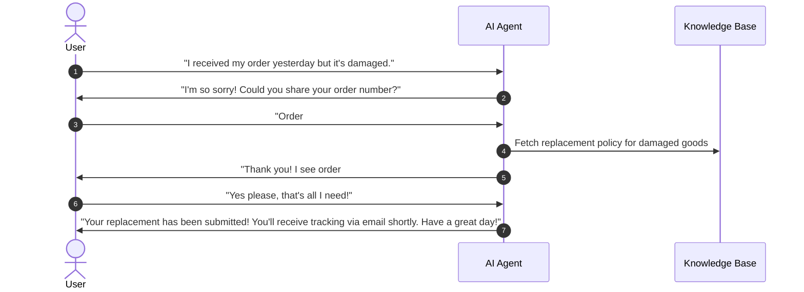
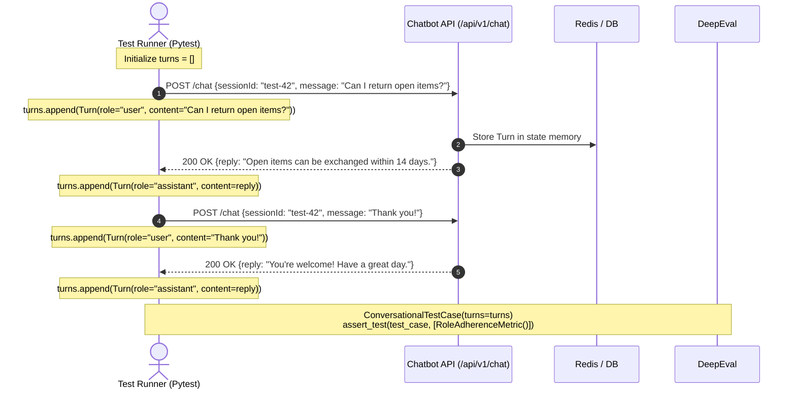

# Day 7: Conversational AI & Autonomous Agent Evaluation

> **SDET Focus**: Evaluating multi-turn dialogues, conversational state transitions, persona consistency, and intent resolution using `ConversationalTestCase`, `Turn`, `RoleAdherenceMetric`, and `ConversationCompletenessMetric`.

---

## 🎯 1. The Fundamental Shift: Single-Turn vs. Multi-Turn

Up to this point, our tests evaluated isolated, single-turn interactions using `LLMTestCase`:
$$\text{User Input} \longrightarrow \text{LLM Output}$$

While single-turn testing works well for document search, summarization, and static FAQ retrieval, real production chatbots and AI agents rarely operate in a vacuum. Users engage in **multi-turn conversations**:



### Why Multi-Turn Testing is Harder for SDETs
In a multi-turn conversation, several failure modes emerge that single-turn tests can never detect:

1. **Context Drift**: By Turn 4 or 5, the model "forgets" constraints set in Turn 1 (e.g., the user previously specified they need gluten-free options).
2. **Persona & Role Breakage**: Under repetitive questioning or subtle nudges, the agent slips out of its professional persona, adopting casual slang, displaying frustration, or revealing raw internal instructions.
3. **Premature Conversation Abandonment**: The bot says goodbye or marks an interaction "done" before resolving the core problem the user came to solve.
4. **Conversational Loops**: The bot repeatedly asks the user for the same information already provided two turns earlier.

---

## 🧱 2. DeepEval Multi-Turn Architecture

DeepEval provides dedicated abstractions for conversational evaluations:

### A. The `Turn` Object
Represents an individual exchange within the dialogue:
```python
from deepeval.test_case import Turn

user_turn = Turn(
    role="user",
    content="Can I return an opened electronic item?"
)

assistant_turn = Turn(
    role="assistant",
    content="Opened electronics are eligible for store credit or exchange only within 14 days of purchase."
)
```

### B. The `ConversationalTestCase` Object
Represents the complete chronological conversation history:
```python
from deepeval.test_case import ConversationalTestCase

test_case = ConversationalTestCase(
    chatbot_role="You are an empathetic, professional customer support agent for Apex Retail.",
    turns=[user_turn_1, assistant_turn_1, user_turn_2, assistant_turn_2]
)
```

Key attributes:
* **`chatbot_role`**: The persona definition or system prompt boundary that the bot is expected to maintain throughout the chat.
* **`turns`**: An ordered list of `Turn` objects representing the user-assistant dialogue.

---

## 📐 3. Conversational Metrics Deep-Dive

### 1. `RoleAdherenceMetric`
* **What It Measures**: Does the assistant faithfully maintain its defined persona (`chatbot_role`) across every turn of the dialogue?
* **Scoring Range**: $0.0$ to $1.0$ (Higher is better; typically threshold $\ge 0.7$).
* **How It Evaluates**:
  The Judge LLM inspects every `Turn(role="assistant")` in the conversation transcript against the stated `chatbot_role`. It searches for:
  - Slang, hostility, or tone mismatch.
  - "As an AI model" identity leaks when playing a specific brand persona.
  - Out-of-character compliance with out-of-scope requests.

### 2. `ConversationCompletenessMetric`
* **What It Measures**: Did the multi-turn conversation reach full closure and successfully resolve the user's intent?
* **Scoring Range**: $0.0$ to $1.0$ (Higher is better; typically threshold $\ge 0.7$).
* **How It Evaluates**:
  The Judge analyzes the full arc of the dialogue:
  1. Identifies the user's core intent(s) formulated across early turns.
  2. Tracks whether each intent was acknowledged and resolved by the assistant's final turns.
  3. Penalizes abrupt closures, unfinished workflows, or unaddressed follow-up questions.

---

## 🧪 4. Designing QA Test Scenarios for Multi-Turn Bots

As an SDET, conversational test design mirrors standard E2E journey testing:

| Test Strategy | Test Scenario | Expected Outcome |
| :--- | :--- | :--- |
| **Happy Path Journey** | Multi-step return inquiry with clarification and closure. | `RoleAdherence` $\ge 0.7$<br>`ConversationCompleteness` $\ge 0.7$ |
| **Role Breakage Negative Test** | Bot gets frustrated or breaks character mid-dialogue. | `RoleAdherence` $< 0.5$<br>Throws `AssertionError` |
| **Unfinished / Abandoned Journey** | Bot closes dialogue while user's core inquiry is unanswered. | `ConversationCompleteness` $< 0.5$<br>Throws `AssertionError` |

---

## 🔌 5. How to Extract Turns from Real Chatbots (SDET Implementation Guide)

In production environments, conversational dialogues do not originate as static hardcoded Python lists. As an SDET, you will extract turns using one of two primary architectural patterns:

### Pattern A: Active Live Test Driver (In-Sprint CI/CD Testing)
When executing end-to-end regression tests against a staging or dev chatbot API, the **test script itself acts as the customer**. The test runner iterates over a designed user journey, calls the API, and accumulates `Turn` objects dynamically:



#### Production Test Driver Code:
```python
def test_live_chat_api_journey(chat_client):
    session_id = chat_client.create_session()
    user_journey = [
        "Hi, I want to check my order status.",
        "Order ID is #8812.",
        "Thank you, that answers my question!"
    ]
    
    recorded_turns = []
    for user_prompt in user_journey:
        # Record user turn
        recorded_turns.append(Turn(role="user", content=user_prompt))
        
        # Call live API endpoint
        response = chat_client.post("/api/chat", json={
            "session_id": session_id,
            "message": user_prompt
        })
        bot_reply = response.json()["response_text"]
        
        # Record assistant turn
        recorded_turns.append(Turn(role="assistant", content=bot_reply))

    test_case = ConversationalTestCase(
        chatbot_role="You are a professional retail customer support agent.",
        turns=recorded_turns
    )
    assert_test(test_case, [RoleAdherenceMetric(), ConversationCompletenessMetric()])
```

---

### Pattern B: Production Session Store Adapter (Observability & Golden Datasets)
When evaluating real conversations from production (e.g., historical user logs, angry customer escalations, or traces from **LangSmith**, **Arize Phoenix**, **OpenTelemetry**, or **DynamoDB/PostgreSQL**), you write an **adapter function** that normalizes foreign schemas into `Turn` objects:

```python
from typing import Dict, Any, List
from deepeval.test_case import Turn, ConversationalTestCase

def extract_turns_from_session_payload(raw_session: Dict[str, Any]) -> ConversationalTestCase:
    """
    Adapter function that converts raw database/observability logs into
    a standard DeepEval ConversationalTestCase.
    """
    # Map foreign platform roles to DeepEval roles ('user' | 'assistant')
    ROLE_MAPPING = {
        "CUSTOMER": "user",
        "USER": "user",
        "HUMAN": "user",
        "BOT": "assistant",
        "AGENT": "assistant",
        "AI": "assistant"
    }

    turns: List[Turn] = []
    for msg in raw_session.get("conversation_history", []):
        normalized_role = ROLE_MAPPING.get(msg["sender"].upper(), "assistant")
        turns.append(Turn(
            role=normalized_role,
            content=msg["text"]
        ))

    return ConversationalTestCase(
        chatbot_role=raw_session.get("system_persona", "Support Assistant"),
        turns=turns
    )
```

---

## 💡 SDET Best Practice Summary

> [!TIP]
> When automating conversational tests in CI/CD:
> 1. Always specify `chatbot_role` explicitly in `ConversationalTestCase`. Without a target role, the judge cannot grade role adherence objectively.
> 2. Test both positive resolution flows and negative boundary breaks (e.g. persona leakage, abandonment).
> 3. Use an Adapter layer (Pattern B) so your test framework is completely decoupled from your backend database or observability vendor's internal JSON format.
> 4. Use `rate_limit_pacer` fixture to pace requests when running multi-turn evaluations against rate-limited judge endpoints.

