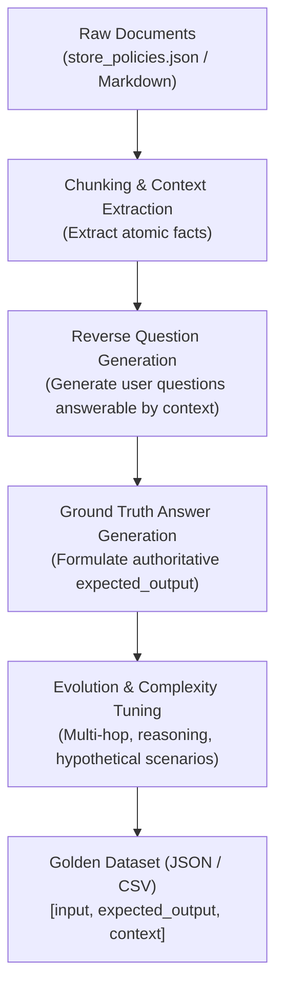
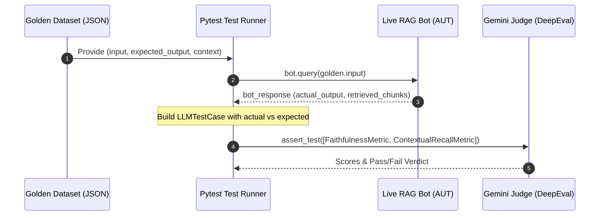

# Day 8: Synthetic Golden Dataset Generation (`Synthesizer`)

> **SDET Focus**: Eliminating the manual test curation bottleneck in RAG evaluation by programmatically generating ground-truth test cases ("Goldens") from enterprise documentation using DeepEval's `Synthesizer`.

---

## 🛑 1. The Bottleneck: Manual Curation vs. Synthetic Generation

In traditional API or UI automation, writing 50 test cases with hardcoded assertions is straightforward:
$$\text{Test Case} = (\text{endpoint}, \text{payload}, \text{expected\_status\_code})$$

In enterprise RAG and LLM systems, evaluating coverage across 100+ company policy documents requires a **Golden Evaluation Dataset**:
$$\text{Golden} = (\text{input\_query}, \text{expected\_output}, \text{ground\_truth\_context})$$

### The Manual Bottleneck:
* Handcrafting 300 diverse question-and-answer pairs by reading through 50 policy documents takes weeks of manual engineering.
* Human test authors exhibit unconscious bias, writing simple, predictable questions that fail to stress-test the model's reasoning capabilities.
* When company policies update (e.g. return window changes from 30 days to 14 days), manually updating hundreds of test fixtures is slow and error-prone.

---

## ⚙️ 2. How Synthetic Generation Works Under the Hood

DeepEval's `Synthesizer` uses an LLM to reverse-engineer test cases directly from raw document context chunks:



1. **Context Extraction**: The synthesizer takes context chunks from your knowledge base.
2. **Reverse Question Formulation**: An LLM generates questions that *require* the specific facts within those chunks to answer.
3. **Ground-Truth Formulation**: The LLM synthesizes an authoritative `expected_output` strictly deduced from the provided context.
4. **Prompt Evolution**: Questions can be evolved to increase difficulty (e.g., adding multi-hop reasoning, comparative questions, or negative constraints).

---

## 🛠️ 3. DeepEval `Synthesizer` Architecture

### Basic Generation from In-Memory Contexts:
```python
from deepeval.synthesizer import Synthesizer

contexts = [
    [
        "Our standard return window is 30 calendar days from the date of delivery. "
        "All returned items must be unopened and in original packaging with receipt."
    ],
    [
        "Electronics and open-box items may only be exchanged within 14 days for store credit. "
        "A 15% restocking fee applies to open-box laptops."
    ]
]

synthesizer = Synthesizer()
goldens = synthesizer.generate_goldens_from_contexts(
    contexts=contexts,
    max_goldens_per_context=2,
    include_expected_output=True
)
```

Each generated item is a `Golden` object containing:
* `input`: A realistic customer inquiry.
* `expected_output`: The authoritative ground truth.
* `context`: The exact document chunk that proves the answer.

### Saving & Exporting Goldens:
Generated datasets can be exported to standard file formats for reuse across CI/CD regression suites:
```python
# Saves to data/synthetic_goldens.json
synthesizer.save_as(
    file_type="json",
    directory="data",
    file_name="synthetic_goldens"
)
```

---

## 🔄 4. The SDET Workflow: Closing the Automation Loop

Once synthetic golden datasets are generated, they serve as the test fixture input for our live Application Under Test (`CustomerSupportRAGBot`):



By pairing the `Synthesizer` with our live RAG bot, we achieve **true closed-loop automation**:
1. Synthetic generation creates the benchmark.
2. The live bot runs against the benchmark.
3. DeepEval metrics verify whether the live bot met or exceeded the golden standard.

---

## 💡 SDET Best Practices for Synthetic Datasets

> [!TIP]
> 1. **Human-in-the-Loop Sanity Check**: Never blindly trust 100% of auto-generated questions for critical regulatory or compliance benchmarks. Review the first 20 generated goldens before freezing the dataset into version control.
> 2. **Version Control Your Goldens**: Store generated datasets in `data/` as static JSON files so that CI/CD runs are fast, deterministic, and do not waste API tokens regenerating benchmarks on every commit.
> 3. **Pair with Contextual Recall**: When evaluating live RAG bots against synthetic datasets, `ContextualRecallMetric` verifies if your retrieval engine fetched all facts specified in `expected_output`.
