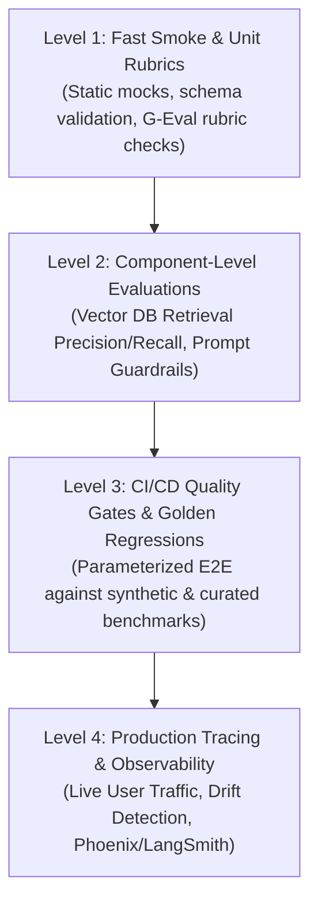
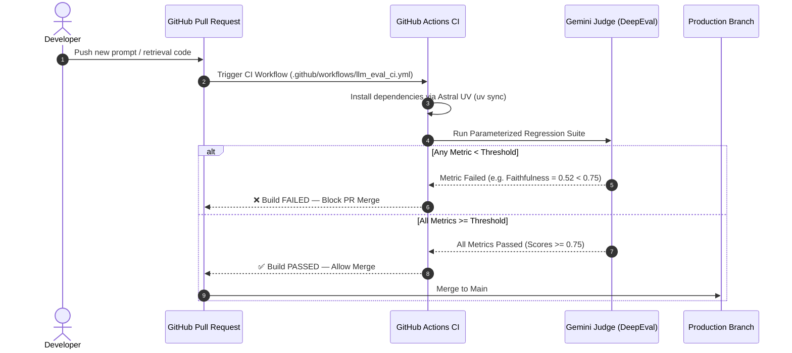

# Day 9: SDET Framework Architecture & CI/CD Quality Gates

> **SDET Focus**: Industrializing LLM evaluation into an automated, data-driven regression testing framework with CI/CD quality gates in GitHub Actions.

---

## 🏛️ 1. Enterprise EvalOps Test Layering

In mature GenAI engineering teams, testing is structured into layers just like traditional QA pyramids:



| Test Layer | Target Component | Execution Cadence | Example Gate |
| :--- | :--- | :--- | :--- |
| **Smoke / Unit** | Prompt templates, parsers, schema | Every commit / PR | Fast static checks ($< 10\text{s}$) |
| **Component (RAG)** | Vector DB search, chunking | PRs touching retrieval code | Contextual Precision $\ge 0.70$ |
| **Safety & Red-Team** | Guardrails, prompt injection | Every release candidate | Toxicity $\le 0.0$, Prompt Leakage $= 0$ |
| **Golden Regression** | Live RAG AUT against datasets | Nightly / Release PRs | Faithfulness $\ge 0.75$, Recall $\ge 0.70$ |

---

## 🔁 2. Data-Driven Testing with `@pytest.mark.parametrize`

Hardcoding test inputs directly inside individual test functions causes code duplication and makes expanding test suites tedious.

In modern SDET frameworks, we use **Data-Driven Testing (DDT)** to decouple **test execution logic** from the **test dataset**:

```python
import pytest
from deepeval import assert_test
from deepeval.test_case import LLMTestCase
from deepeval.metrics import FaithfulnessMetric, AnswerRelevancyMetric

def load_goldens():
    # Reads benchmark dataset from data/synthetic_goldens.json
    ...

@pytest.mark.parametrize(
    "golden",
    load_goldens(),
    ids=[f"golden_{idx}_{g['topic']}" for idx, g in enumerate(load_goldens())]
)
def test_live_rag_against_dataset(bot, golden):
    # 1. Query live SUT with the golden's query
    response = bot.query(golden["input"])

    # 2. Build test case dynamically
    test_case = LLMTestCase(
        input=golden["input"],
        actual_output=response.answer,
        expected_output=golden["expected_output"],
        retrieval_context=response.retrieved_chunks
    )

    # 3. Assert quality gate
    assert_test(test_case, [
        FaithfulnessMetric(threshold=0.7),
        AnswerRelevancyMetric(threshold=0.7)
    ])
```

### Why Dynamic `ids` Matter:
In Pytest, specifying `ids=[...]` transforms unreadable test names like `test_live_rag[golden0]` into clear, actionable reporting names like `test_live_rag[golden_1_Returns_and_Refunds]`. When a build fails in CI, the team immediately knows which topic regressed.

---

## 🚦 3. Designing CI/CD Quality Gates

A **Quality Gate** is an automated pass/fail checkpoint that prevents defective code from merging into production:



### Hard Gates vs. Soft Gates:
* **Hard Gates (Blocking)**:
  * Prompt Leakage / Jailbreak Vulnerabilities.
  * Toxicity & Bias ($\text{Score} < 0.8$).
  * Factual Faithfulness on legal/monetary policies ($\text{Score} < 0.70$).
  * *Action*: PR merge button is disabled; developer must fix before merging.
* **Soft Gates (Non-Blocking / Monitoring)**:
  * Slight latency fluctuations ($\pm 15\%$).
  * Stylistic conciseness or tone nuances.
  * *Action*: Log warning or post a PR comment summary without failing the build.

---

## 🚀 4. GitHub Actions Workflow Architecture

To run DeepEval reliably in CI/CD without exceeding API budgets or slowing down teams:

1. **Use Astral `uv`**:
   Using `astral-sh/setup-uv` restores dependencies from `uv.lock` in under 3 seconds, cutting minutes off GitHub Actions runners compared to standard `pip install`.
2. **Inject Secrets Securely**:
   Pass `GOOGLE_API_KEY` and model flags from GitHub Repository Secrets (`${{ secrets.GOOGLE_API_KEY }}`).
3. **Pace API Calls**:
   The `rate_limit_pacer` fixture in `conftest.py` ensures CI runners respect the 15 RPM free tier quota without throwing `429 RESOURCE_EXHAUSTED`.
4. **Generate Standard Reports**:
   Run with `--junitxml=reports/junit.xml` to generate test reports natively recognized by GitHub Actions.
