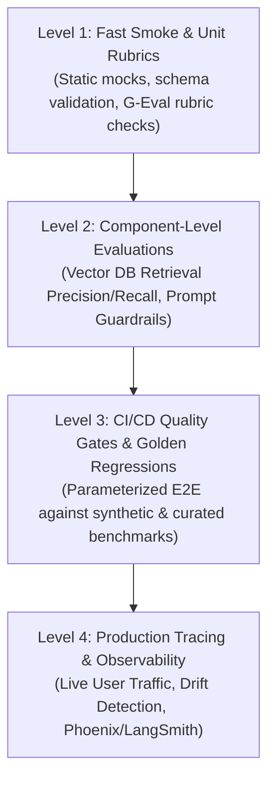
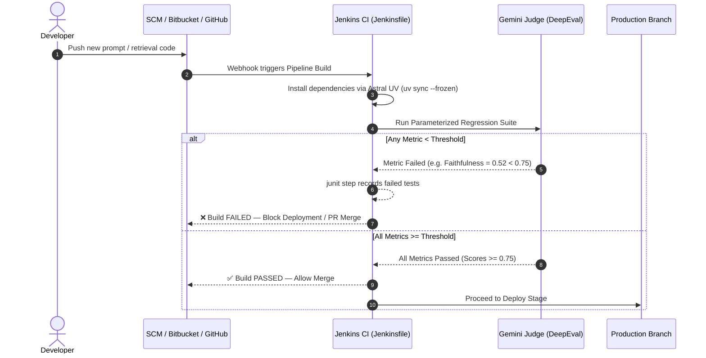

# Day 9: SDET Framework Architecture & CI/CD Quality Gates

> **SDET Focus**: Industrializing LLM evaluation into an automated, data-driven regression testing framework with CI/CD quality gates in GitHub Actions.

---

## 🏛️ 1. Enterprise EvalOps Test Layering

In mature GenAI engineering teams, testing is structured into layers just like traditional QA pyramids:



| Test Layer | Target Component | Execution Cadence | Example Gate |
| :--- | :--- | :--- | :--- |
| **Smoke / Unit** | Prompt templates, parsers, schema | Every commit / PR | Fast static checks ($< 10\text{s}$) |
| **Component (RAG)** | Vector DB search, chunking | PRs touching retrieval code | Contextual Precision $\ge 0.70$ |
| **Safety & Red-Team** | Guardrails, prompt injection | Every release candidate | Toxicity $\le 0.0$, Prompt Leakage $= 0$ |
| **Golden Regression** | Live RAG AUT against datasets | Nightly / Release PRs | Faithfulness $\ge 0.75$, Recall $\ge 0.70$ |

---

## 🔁 2. Data-Driven Testing with `@pytest.mark.parametrize`

Hardcoding test inputs directly inside individual test functions causes code duplication and makes expanding test suites tedious.

In modern SDET frameworks, we use **Data-Driven Testing (DDT)** to decouple **test execution logic** from the **test dataset**:

```python
import pytest
from deepeval import assert_test
from deepeval.test_case import LLMTestCase
from deepeval.metrics import FaithfulnessMetric, AnswerRelevancyMetric

def load_goldens():
    # Reads benchmark dataset from data/synthetic_goldens.json
    ...

@pytest.mark.parametrize(
    "golden",
    load_goldens(),
    ids=[f"golden_{idx}_{g['topic']}" for idx, g in enumerate(load_goldens())]
)
def test_live_rag_against_dataset(bot, golden):
    # 1. Query live SUT with the golden's query
    response = bot.query(golden["input"])

    # 2. Build test case dynamically
    test_case = LLMTestCase(
        input=golden["input"],
        actual_output=response.answer,
        expected_output=golden["expected_output"],
        retrieval_context=response.retrieved_chunks
    )

    # 3. Assert quality gate
    assert_test(test_case, [
        FaithfulnessMetric(threshold=0.7),
        AnswerRelevancyMetric(threshold=0.7)
    ])
```

### Why Dynamic `ids` Matter:
In Pytest, specifying `ids=[...]` transforms unreadable test names like `test_live_rag[golden0]` into clear, actionable reporting names like `test_live_rag[golden_1_Returns_and_Refunds]`. When a build fails in CI, the team immediately knows which topic regressed.

---

## 🚦 3. Designing CI/CD Quality Gates

A **Quality Gate** is an automated pass/fail checkpoint that prevents defective code from merging into production:



### Hard Gates vs. Soft Gates:
* **Hard Gates (Blocking)**:
  * Prompt Leakage / Jailbreak Vulnerabilities.
  * Toxicity & Bias ($\text{Score} < 0.8$).
  * Factual Faithfulness on legal/monetary policies ($\text{Score} < 0.70$).
  * *Action*: Jenkins pipeline exits with code 1; build is marked **UNSTABLE / FAILED**, blocking deployment.
* **Soft Gates (Non-Blocking / Monitoring)**:
  * Slight latency fluctuations ($\pm 15\%$).
  * Stylistic conciseness or tone nuances.
  * *Action*: Log warning or archive metric trends without failing the build.

---

## 🏗️ 4. Enterprise Jenkins Pipeline Architecture (`Jenkinsfile`)

In enterprise organizations using Jenkins, pipelines are written using **Declarative Pipeline syntax** (Groovy) inside a `Jenkinsfile` at the root of the repository:

```groovy
pipeline {
    agent {
        // Run on a Docker agent with Python 3.12 or a configured Linux build agent
        docker {
            image 'python:3.12-slim'
        }
    }

    environment {
        // Securely inject secrets from Jenkins Credential Store
        GOOGLE_API_KEY    = credentials('google-gemini-api-key')
        GEMINI_MODEL_NAME = 'gemini-3.5-flash-lite'
        USE_GEMINI_MODEL  = 'Y'
    }

    stages {
        stage('Checkout') {
            steps {
                checkout scm
            }
        }

        stage('Setup Tooling & Dependencies') {
            steps {
                sh '''
                    # Install Astral UV for fast deterministic dependency sync
                    curl -LsSf https://astral.sh/uv/install.sh | sh
                    export PATH="$HOME/.local/bin:$PATH"
                    uv sync --frozen
                '''
            }
        }

        stage('Run LLM Quality Gates & Regressions') {
            steps {
                sh '''
                    export PATH="$HOME/.local/bin:$PATH"
                    mkdir -p reports
                    uv run pytest tests/test_00_smoke.py tests/test_08_dataset_parametrized_regression.py \
                        -v --junitxml=reports/junit.xml
                '''
            }
        }
    }

    post {
        always {
            // Jenkins native JUnit plugin parses XML and renders test trend charts
            junit testResults: 'reports/junit.xml', allowEmptyResults: false
        }
        failure {
            echo "❌ Quality Gate breached! One or more LLM evaluation metrics failed threshold."
        }
        success {
            echo "✅ All LLM Quality Gates passed successfully!"
        }
    }
}
```

### Why This Jenkins Integration is Enterprise-Ready:
1. **JUnit Plugin Native Support**: Pytest generates `--junitxml=reports/junit.xml`, which Jenkins automatically turns into interactive pass/fail graphs, historical trend curves, and failure breakdown tables without third-party plugins.
2. **Credential Masking**: Jenkins `credentials(...)` automatically masks `GOOGLE_API_KEY` from build console logs, preventing API key exposure.
3. **Deterministic Fast Builds**: Using `uv sync --frozen` installs dependencies from `uv.lock` in seconds, eliminating build agent cache churn.
4. **Rate-Limit Safe**: The test framework's `rate_limit_pacer` fixture paces requests automatically, preventing `429 RESOURCE_EXHAUSTED` failures across distributed Jenkins executors.

