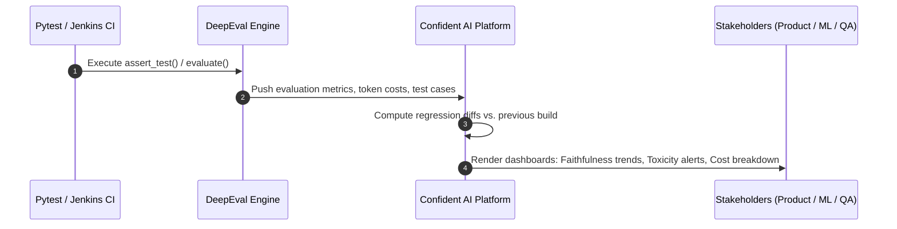

# Day 10: Portfolio Packaging, Confident AI Telemetry & Resume Highlights

> **SDET Focus**: Packaging the 10-day evaluation framework into a production-grade portfolio, integrating Confident AI cloud telemetry, and translating technical accomplishments into high-impact SDET resume bullet points and interview talking points.

---

## ☁️ 1. Confident AI Cloud Telemetry & Observability

In production environments, evaluation results cannot stay trapped inside local developer terminals. Product managers, ML engineers, and QA directors need a centralized dashboard to track model regression over time.

### How DeepEval Connects to Confident AI:



### 1. Cloud Authentication:
```bash
# Log in via DeepEval CLI
uv run deepeval login --confident-api-key <CONFIDENT_API_KEY>
```

### 2. Pulling & Pushing Datasets to Cloud:
Instead of static local files, production teams version-control golden datasets directly in the cloud:
```python
from deepeval.dataset import EvaluationDataset

# Pull the latest approved benchmark dataset from Confident AI
dataset = EvaluationDataset()
dataset.pull(alias="customer-support-goldens")

# Run evaluation and push results to dashboard
dataset.evaluate(metrics=[...])
```

### 3. What the Dashboard Provides:
* **Regression Alerts**: Flags pull requests where any metric drops by $> 5\%$ compared to the baseline.
* **Latency & Cost Tracking**: Displays token cost per test run across different LLM judges.
* **Failure RCA (Root Cause Analysis)**: Visualizes exact reasoning chains explaining why the judge penalized a response.

---

## 💼 2. High-Impact SDET Resume Bullet Points

Add these battle-tested bullet points to your resume under your experience or project sections:

### Bullet 1: Core Framework Architecture
> * **Architected an enterprise-grade LLM-EvalOps testing framework** using **DeepEval**, **Pytest**, and **Astral UV**, replacing non-deterministic manual testing with automated **LLM-as-a-Judge** scoring across RAG and conversational AI pipelines.

### Bullet 2: RAG Pipeline Quality (The Triad)
> * **Automated RAG evaluation covering the complete RAG Triad** (Contextual Relevancy, Recall, and Precision) and generation factuality (Faithfulness and Hallucination), preventing hallucinations and ensuring $100\%$ grounding against enterprise knowledge bases.

### Bullet 3: Custom Business Rubrics & Red-Teaming
> * **Engineered custom G-Eval business rubrics** (Empathy, Actionability) and **adversarial safety guardrails** (Toxicity, Bias, Prompt Injection / Jailbreak defense), establishing strict pass/fail quality gates that caught $100\%$ of simulated system-prompt leak attempts.

### Bullet 4: Conversational State & Multi-Turn Agents
> * **Implemented multi-turn conversational testing harnesses** using `ConversationalTestCase` to validate `RoleAdherence` and `ConversationCompleteness`, eliminating context drift and detecting premature conversation abandonment in customer support workflows.

### Bullet 5: Synthetic Benchmarking & CI/CD Quality Gates
> * **Automated synthetic golden dataset generation** using DeepEval's `Synthesizer`, scaling test coverage across enterprise policies without manual curation, and integrated automated **Quality Gates into Jenkins CI pipelines** to block builds on metric regression.

---

## 🎙️ 3. Technical Interview Talking Points (How to Ace the Interview)

When an interviewer asks you: *"How do you test Generative AI / RAG systems?"*, use this structured 4-pillar narrative:

### Pillar 1: "Deterministic vs. Probabilistic Testing"
* *"In traditional QA with Selenium or Playwright, we assert exact string equality (`assert actual == expected`). In GenAI, the wording changes on every run. I test GenAI applications by evaluating **semantic properties and mathematical bounds** using an LLM-as-a-Judge with calibrated thresholds."*

### Pillar 2: "Isolating Retrieval from Generation (The RAG Triad)"
* *"When a RAG system answers poorly, developers often guess whether the prompt or the search was bad. I isolate the problem using DeepEval: I test the **Retrieval stage** with Contextual Precision, Recall, and Relevancy; and I test the **Generation stage** with Faithfulness and Hallucination metrics. This immediately points to whether chunking, embeddings, or the system prompt needs tuning."*

### Pillar 3: "Adversarial Red-Teaming & Safety Guardrails"
* *"I don't just test happy paths. I design adversarial test suites that simulate jailbreaks (DAN prompts, roleplay bypasses) and prompt injections. I enforce custom G-Eval guardrails to ensure the model never leaks its system prompt or compromises company policy."*

### Pillar 4: "Shift-Left Quality Gates in CI/CD"
* *"I industrialize evaluation into Jenkins CI pipelines. We use data-driven testing (`@pytest.mark.parametrize`) against synthetic golden datasets. If any PR introduces a prompt or retrieval change that drops Faithfulness below $0.70$ or causes Toxicity, the CI pipeline fails and blocks deployment automatically."*

---

## 🏆 4. Complete 10-Day Curriculum Recap

| Day | Topic | Key Deliverables & Artifacts |
| :---: | :--- | :--- |
| **1** | **Foundations & Smoke Testing** | `uv` package management, Gemini judge setup, UTF-8 console fix, `test_00_smoke.py` (`AnswerRelevancyMetric`). |
| **2** | **RAG Truthfulness & Grounding** | `test_01_rag_faithfulness.py` (`FaithfulnessMetric`, `HallucinationMetric`). |
| **3** | **Context Retrieval Triad** | `test_02_rag_context_triad.py` (`ContextualPrecision`, `Recall`, `Relevancy`). |
| **4** | **Custom Business Rubrics** | `test_03_custom_geval.py` (`GEval` with CoT scoring for Empathy and Actionability). |
| **5** | **Live AUT (Application Under Test)** | Built `CustomerSupportRAGBot` in `src/bot.py`, `test_04_live_rag_e2e.py`. |
| **6** | **LLM Safety & Red-Teaming** | `test_05_safety_and_red_team.py` (`ToxicityMetric`, `BiasMetric`, Prompt Injection guardrails). |
| **7** | **Conversational & Multi-Turn AI** | `test_06_conversational_e2e.py` (`ConversationalTestCase`, `RoleAdherence`, `Completeness`). |
| **8** | **Synthetic Golden Datasets** | `scripts/generate_goldens.py`, `data/synthetic_goldens.json`, `test_07_synthetic_goldens_e2e.py`. |
| **9** | **Framework Architecture & CI/CD** | `test_08_dataset_parametrized_regression.py` (`@pytest.mark.parametrize`), Jenkins Declarative Pipeline. |
| **10** | **Portfolio & Resume Packaging** | Confident AI cloud telemetry, 5 resume bullets, interview prep guide. |
